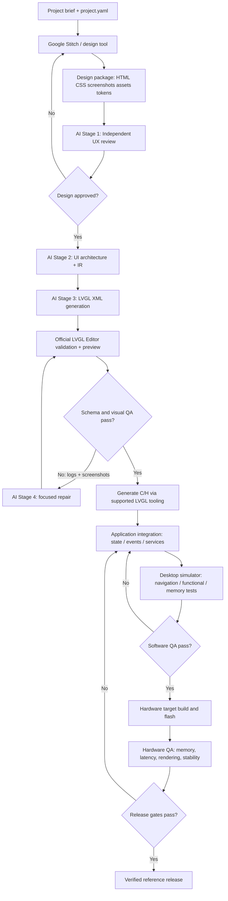

# Generic AI-Powered LVGL HMI Development Framework

> **V2 guidance:** This document preserves the original prompts and reference architecture. For the current skill, decision rules, feasibility assessment, optional Foundation / AI Design modes, and production gates, start with [SKILL.md](SKILL.md). The XML-only diagrams and fixed prompt sequence below describe the original proposed path, not a mandatory workflow.

**Purpose:** A reusable, hardware-agnostic, design-to-firmware workflow for LVGL-based HMIs.

**Status:** Architecture and reusable prompt template; not a validated production implementation. Tool capabilities and licenses must be checked for the versions you actually install.

## 1. Reference architecture



**Tooling note:** Google Stitch's exported frontend code is design input, not LVGL XML. Conversion is AI-assisted and subject to verification. LVGL Pro Editor/CLI capabilities and licensing vary by release/plan; do not assume unrestricted CLI automation or runtime XML use. Generated C/H should be treated as disposable build artifacts. The reference pipeline does not promise zero crashes or pixel-perfect conversion.

## 2. Separation of concerns

- **Design source:** design screenshots, HTML/CSS, design tokens, visual assets, screen specs.
- **UI IR (project-owned):** explicit widget tree, layout, UI states, event contracts, asset references, navigation. Not an official LVGL interchange standard.
- **LVGL XML:** source for the UI implementation, conforming to the *installed editor's* actual XML schema.
- **Generated C/H:** machine-generated output; never hand-edit for permanent changes.
- **Presentation layer:** binds application state to UI and translates UI events into user intents.
- **Application model/controller:** single source of truth, input validation, async operations, error handling.
- **Platform adapters:** LVGL display/touch backend, scheduler/threading, transport, hardware integration.

## 3. Generic configuration: `project.yaml`

```yaml
project:
  name: generic_hmi
  domain: appliance  # replace for each product
  description: "Touchscreen control interface"
target:
  width: 800
  height: 1280
  orientation: portrait
  touch: true
  touch_target_min_px: 48 # design preference; assess actual screen density
  platforms: [desktop_sdl, esp32_p4]
software:
  lvgl_version: "PIN_EXACT_VERSION"
  editor_version: "PIN_EXACT_VERSION"
  firmware_framework: esp_idf
  language: C
visual:
  theme: clean_modern
  required_states: [normal, pressed, selected, disabled, pending, error, disconnected]
  font_licenses_verified: false
ux:
  user_flows: [home, adjust_value, settings]
  languages: [en]
  accessibility_review_required: true
engineering:
  prefer_flex_grid: true
  generated_code_read_only: true
  application_state_single_source: true
  evidence_required_for_pass: true
quality_budgets:
  heap_max_bytes: null      # establish after measuring real hardware
  psram_max_bytes: null
  refresh_fps_min: null
  touch_latency_max_ms: null
  boot_time_max_ms: null
licensing:
  editor_entitlement_verified: false
  cli_entitlement_verified: false
```

Never assume generic values represent tested hardware capabilities. Pin versions, limits, and acceptance criteria per project.

## 4. Prompt usage contract

Each prompt consumes `project.yaml`, outputs from the previous stage, and `ai/AGENTS.md`. Run prompts **separately**; require evidence at each quality gate. Use the exact documentation/schema for installed LVGL tooling.

### Prompt 1 — Design generation (Google Stitch)

```text
Act as a Senior Product Designer and Embedded HMI UX Specialist.

Use the attached project.yaml as the source of truth. Create a polished, visually consistent, intuitive touchscreen HMI for the specified product, screen dimensions, target user, and capabilities. Do not assume any particular appliance or board beyond the configuration.

Requirements:
- Clear information hierarchy, purposeful whitespace, consistent spacing, typography, iconography, colors, and reusable components.
- Navigation should be easy to learn; important functions require minimal steps.
- Adequate touch targets and spacing for the physical display; accessible contrast and readable text.
- No knowingly overlapping widgets, clipping, out-of-bounds content, misleading states, or duplicate contradictory controls.
- Represent all relevant normal, pressed, selected, disabled, pending, failure, disconnected, empty, and recovery states.
- Distinguish requested operations from confirmed device state. Explain risky/destructive operations and confirmation behavior.
- Favor effects and layout patterns realistically implementable in LVGL; avoid excessive CSS filters, blur, layering, and heavy animations.
- Prefer simple graphical primitives and reusable assets that respect embedded memory/performance constraints.
- Do not invent product functions: list assumptions.

Deliver: screen designs, navigation and user flows, component variants, state inventory, tokens, asset list, visual references, and HTML/CSS/source export if the tool supports it. Include a brief rationale and identified risks. Design for handoff, not just visual appeal.
```

### Prompt 2 — Independent design and UX audit

```text
Act as an independent Senior UX Auditor and Embedded HMI QA Engineer. Critique the supplied approved-design candidate independently; do not rubber-stamp it.

Inputs: project.yaml, requirements, screen images at target resolution, HTML/CSS if available, design tokens, interaction/navigation specs.

Audit each screen and state for overlap, clipping, offscreen elements, text truncation, inconsistent alignment/spacing, low contrast, small or adjacent touch targets, duplicated controls, inconsistent state, unclear hierarchy, confusing navigation, missing empty/pending/error/recovery states, accidental activation risks, and expensive embedded graphics.

Validate cross-screen consistency: selected mode, displayed values, error presentation, navigation, confirmation and back behavior. Identify untested responsive/language variants.

Output: issue table (ID, severity, evidence/screen/component, root cause, smallest corrective action), missing-state inventory, required design changes, and verdict PASS / PASS WITH CHANGES / FAIL.

Distinguish OBSERVED versus INFERRED versus NOT TESTED. Never claim visual or accessibility compliance without actual inspection and relevant checks. Do not generate LVGL XML in this stage.
```

### Prompt 3 — UI architecture and intermediate representation

```text
Act as a Senior Embedded GUI Architect specializing in the pinned LVGL version.

Inputs: project.yaml, approved designs, screenshots, HTML/CSS, design tokens, assets, UX audit and product behavior contract.

Produce a PROJECT-DEFINED UI IR (JSON), not alleged official LVGL XML: screens, stable component IDs, semantic widget types, hierarchy, layout constraints, style tokens, asset keys, text identifiers, semantic events, state/visibility rules, navigation map, reusable components, and interaction contracts.

Rules: separate visual state and authoritative application model; one source of truth; reusable components; unique IDs; map each action to a documented intent; define pending/success/failure behavior; plan localization and text overflow. Prefer Flex/Grid-compatible layout concepts; flag unsupported web effects. Never couple view objects directly to hardware transport.

Deliver ui-spec.json, components.json, design-tokens.json, asset-manifest.json, navigation-map.md, event-contracts.md, and an assumptions/unsupported-features report. Validate JSON syntax, unique IDs, references, and coverage of UX-required states before asserting completeness. Do not generate XML yet.
```

### Prompt 4 — Schema-grounded LVGL XML generation

```text
Act as a Senior LVGL XML Engineer. Generate XML compatible with the EXACT installed LVGL Pro Editor version and actual XML schema. Use project.yaml and approved UI IR as the contract.

Before coding, inspect version-matched official documentation, project examples, existing XML project structure, and supported widgets/properties. If these are not available, STOP and identify missing schema information: DO NOT INVENT XML TAGS OR ATTRIBUTES.

Use reusable components, stable IDs, shared styles, supported layout mechanisms, correct asset paths and event contracts. Keep generated UI declarative and isolated from application/hardware logic. Preserve approved design intentions, document every approximation for unsupported effects, and avoid needless allocations and animations.

Deliver editable LVGL XML source, assets/config manifests, a generated-file policy, event interface mapping, and a conversion deviations report. Run XML syntax and official editor/schema validation if actually available. Report logs and exact PASS / FAIL / NOT TESTED status for each check. Never claim compatibility based only on plausibility.
```

### Prompt 5 — Visual validation and minimal repair

```text
Act as a Visual Regression Engineer and LVGL UI QA specialist.

Inputs: source-design screenshots, actual LVGL render captures at the configured resolution, UI IR, XML, validation/build logs, approved tokens, target states and user flows.

Compare geometry, alignment, spacing, text, fonts, clipping, overlap, iconography, color, missing/duplicate elements, component consistency, visual hierarchy, and relevant UI states. Audit expected interactions separately from visual rendering.

For each discrepancy, provide location/element ID, source evidence, severity, likely cause and minimal fix. Modify only affected XML/component sources; re-run actual validation and render; repeat until tests pass or blockers are documented. Preserve already-approved behavior and avoid blind full regeneration.

Outputs: defects.csv or markdown table, comparison report, changes, real before/after screenshots when available, tool logs, and PASS / FAIL / NOT TESTED per criterion. Do not invent screenshots, tool results, pixel-perfect claims or test coverage. Prioritize usable and correctly functioning LVGL UI over exact imitation of web effects.
```

### Prompt 6 — Firmware integration, performance and reliability QA

```text
Act as a Principal Embedded Software Engineer, safety-conscious UI integrator, and test engineer.

Inputs: project.yaml, LVGL-generated C/H, event contracts, application requirements, existing project architecture, platform SDK/board support package and documented LVGL threading API for the pinned versions.

Integrate generated UI without editing generated files. Separate presentation, model/controller, services, and platform display/touch/transport adapters. Keep application state authoritative, validate user inputs, differentiate requested/pending/confirmed/failed actions, and never imply device commands succeeded before acknowledgement.

Reliability requirements: safe LVGL object ownership and lifetime; no stale pointers, double event subscriptions/timers, allocation misuse, unsafe cross-thread widget access, blocking callbacks, unmanaged async updates, or lost state during screen transitions. Marshal UI changes into the allowed LVGL execution context or supported synchronization path. Respect safety-critical controls outside the UI layer.

Test: clean target builds, simulator behavior, navigation and state transitions, repeated taps, rapid screen lifecycle, timeouts/disconnections/malformed data, memory leak and resource checks, applicable static analysis and unit tests. On actual boards, measure heap/PSRAM, frame rate, latency, load, boot, long-run stability. Define acceptance budgets from measurements and product requirements; do not invent thresholds.

Deliver code changes, build/test commands and logs, PASS / FAIL / NOT TESTED matrix, performance evidence, remaining risks, and release gate verdict. Never promise 'crash-free' without evidence.
```

## 5. Shared agent rules: `ai/AGENTS.md`

```text
# Generic Embedded HMI AI Engineering Rules
Read project.yaml first. Pin tool versions and requirements. Work only in scope.
Priority: correctness and safety > stability > usability/accessibility > visual consistency > maintainability > performance > polish.
Never invent API names, LVGL XML schema fields, tool capabilities, licensing entitlements, logs, screenshots, or test success.
Respect ownership: design -> project-specific IR -> LVGL XML -> GENERATED C/H (read-only) -> handwritten application -> platform.
One authoritative application state; never conflate a UI request with a confirmed hardware operation.
Use supported synchronization for LVGL. Keep callbacks non-blocking. Manage object lifetime, async updates, event/timer subscriptions, and resource cleanup.
Make minimal changes, prefer reusable components, avoid unrelated refactors and overwriting handwritten code.
For every deliverable, document source versions, assumptions, artifacts, exact validation run, PASS/FAIL/NOT TESTED, regressions, and remaining risks.
A clean visual preview does not prove firmware reliability. A simulator pass does not prove hardware performance or safety.
```

## 6. Suggested repository structure

```text
generic-hmi/
├── project.yaml
├── README.md
├── design/
│   ├── source/             # Stitch exports and images
│   ├── assets/
│   └── tokens/
├── ai/
│   ├── AGENTS.md
│   └── ir/                 # JSON, maps, contracts
├── ui/
│   ├── xml/                # Maintained LVGL XML
│   └── generated/          # Read-only C/H artifacts
├── app/
│   ├── presentation/
│   ├── model/
│   └── services/
├── platform/
│   ├── desktop_sdl/
│   └── targets/            # One adapter per MCU/MPU
├── tests/
│   ├── visual/
│   ├── functional/
│   └── integration/
└── reports/                # Evidence, baseline, test logs
```

## 7. Quality gates and evidence

| Gate | Evidence | Pass criterion |
|---|---|---|
| Design approval | Target-resolution screenshots, flow/state review | No unresolved critical/high UX problem |
| XML compatibility | Official version-matched schema validation and render | Valid XML; required components/states render |
| Visual accuracy | LVGL screenshots + inspected comparisons | No known critical/high visual defects in tested states |
| Functional behavior | Simulator execution and automated/manual cases | Defined navigation, controls, and state transitions pass |
| Embedded correctness | Target build and platform integration tests | Build passes; no known critical/high integration issues |
| Hardware release | On-board resource, touch latency, rendering, stress tests | Measurements meet project-specific agreed budgets |

Mark unknown measurements as NOT TESTED, not PASS.

## 8. Reuse policy

For a new device, change `project.yaml`, hardware adapters, assets, user flows, and acceptance budgets. Reuse the six prompts, gate definitions, XML generation discipline, and app/platform separation. Do not assume a different MCU, language, OS, or display connector is interchangeable without validating its backend, memory, and toolchain.

## 9. Minimal viable adoption

1. Select one screen and 2-3 interactions.
2. Run Stage 1-4; validate in the official editor (manual where CLI unavailable).
3. Render and compare screen captures; run Stage 5.
4. Generate C, wire mock application state, and run desktop simulator.
5. Only then integrate with target hardware using Stage 6.
6. Record a repeatable baseline release before expanding.

**External references to verify:** https://stitch.withgoogle.com/ ; https://docs.lvgl.io/ ; https://lvgl.io/ ; https://github.com/lvgl/lvgl ; vendor SDK documentation for each selected target.
